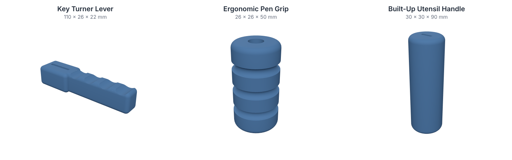
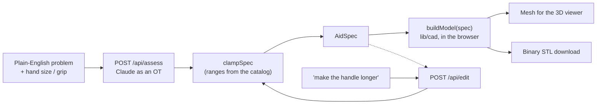

# Grippy

> **Tell us what's hard. We'll design the tool.**
> Describe a daily task in plain English. AI picks and sizes an adaptive aid, you see it in 3D, tweak it by talking, and download a 3D-printable STL.

[](https://github.com/aryankumar1124/Grippy-ai/actions/workflows/ci.yml)
[](LICENSE)



<sub>The three aids at their default sizes, rendered from the 3D engine's own mesh output.</sub>

Built at the **Nittany AI Vibeathon**. Inspired by the open-source *text-to-cad* idea; the pipeline, the AI occupational-therapist reasoning and the talk-to-edit loop are our own.

> **Disclaimer:** Grippy is a hackathon prototype. It is not a medical device and does not replace an occupational therapist. Check the fit of any printed aid before relying on it.

---

## How it works

1. **Describe the problem**, e.g. *"My grandma has arthritis and can't turn her house key."* Optionally add hand size (S/M/L) and grip strength (low/medium).
2. **AI occupational therapist.** Claude chooses the best aid from a small catalog, sizes it to the person, explains the mechanism in a sentence or two, and adds safety notes.
3. **3D model.** The parameters are turned into real geometry in the browser, so you can rotate it.
4. **Edit by talking.** *"Make the handle longer and add finger grooves"* changes only the parameters that instruction implies.
5. **Download** a print-ready binary STL (millimetres, flat base).



More detail in [docs/ARCHITECTURE.md](docs/ARCHITECTURE.md).

## The aids

| Aid | What it does | Parameters (mm unless noted) |
|---|---|---|
| **Key Turner Lever** | Lever that slots over a key bow for extra leverage | `handleLength` 60-140 · `handleThickness` 12-30 · `slotWidth` 20-35 · `gripGrooves` 0/1 |
| **Ergonomic Pen Grip** | Thick sleeve that slides over a pen or pencil | `outerDiameter` 18-40 · `length` 30-80 · `penDiameter` 6-12 · `gripGrooves` 0/1 |
| **Built-Up Utensil Handle** | Thick handle sleeve for forks and spoons | `outerDiameter` 20-45 · `length` 60-130 · `slotWidth` 4-15 · `slotThickness` 1.5-5 |

The catalog is the single source of truth: [`lib/catalog.ts`](lib/catalog.ts). The AI prompts, the validator and the 3D engine all read the ranges from it.

## Quick start

Requires **Node 18.17+** (20 recommended, see `.nvmrc`).

```bash
git clone https://github.com/aryankumar1124/Grippy-ai.git
cd Grippy-ai
npm install
cp .env.local.example .env.local   # add your ANTHROPIC_API_KEY
npm run dev                         # http://localhost:3000
```

No API key? `/api/assess` falls back to an offline keyword-based picker, so you can still build and demo the UI. (`/api/edit` needs the key; without it, it returns the design unchanged with a message.)

Environment variables:

| Variable | Required | Default | Purpose |
|---|---|---|---|
| `ANTHROPIC_API_KEY` | for live AI | none | Server-side only. Never commit `.env.local`. |
| `ANTHROPIC_MODEL` | no | `claude-sonnet-5-5` | Override the model used by both routes. |

## Scripts

| Command | What it does |
|---|---|
| `npm run dev` | Start the dev server |
| `npm run build` / `npm start` | Production build / serve it |
| `npm run lint` | ESLint (Next.js config) |
| `npm run typecheck` | `tsc --noEmit` under the strict config |
| `npm run verify:cad` | Build every aid at min / default / max parameters and check the output (see below) |
| `npm run export:stl` | Write a print-ready STL for each aid to `./stl-out` (`-- --out <dir>`, or `-- --spec <file.json>` for one design) |
| `npm run check` | Lint + typecheck + verify:cad, the same things CI runs before the build |

## API

| Route | Body | Returns |
|---|---|---|
| `POST /api/assess` | `IntakeInput` | `{ spec: AidSpec, fallback?: true }` |
| `POST /api/edit` | `{ spec, instruction }` | `{ spec, changeSummary }` |

```bash
curl -s localhost:3000/api/assess \
  -H 'content-type: application/json' \
  -d '{"problem":"I have arthritis and can'\''t turn my house key","gripStrength":"low"}'
```

Shared types live in [`lib/types.ts`](lib/types.ts). Both routes always return a valid, clamped `AidSpec`, so the 3D engine never receives out-of-range input.

## 3D engine (`lib/cad`)

`buildModel(spec)` returns `{ mesh, stl }` and never throws: bad numbers are clamped, a failing template falls back to that aid's default model, and as a last resort a plain block is returned.

- **`mesh`** is y-up (three.js coordinates) with smooth normals, ready for a `BufferGeometry`.
- **`stl`** is a binary STL `Blob` in **millimetres, z-up, with a flat base at z = 0**, so it prints as exported.
- Fixed print allowances sit at the top of each template: 3 mm key slot, +0.3 mm pen-hole clearance, 2 mm minimum wall.

`npm run verify:cad` checks, for every aid at min / default / max parameters (grooves on and off): a non-trivial mesh, STL and mesh triangle counts that agree, finite numbers, base at z = 0, positive volume, a closed surface, and that bad input does not throw.

## Project structure

```
app/
  api/assess/        POST: problem -> AidSpec (Claude as an OT)
  api/edit/          POST: spec + instruction -> updated AidSpec
  page.tsx           the single page: intake, results, viewer
components/          UI components (viewer, cost panel, ...)
lib/
  types.ts           shared contract (AidSpec, IntakeInput, MeshData)
  catalog.ts         the 3 aids and their parameter ranges
  ai/                Claude client, prompts, validation, offline fallback
  cad/               geometry: templates, mesh, STL, buildModel
data/                prices and impact stats
docs/                architecture notes, impact research, testing notes, images
scripts/verify.ts    3D engine verification
```

## Contributing

Branches, folder ownership and the pre-PR checklist are in [CONTRIBUTING.md](CONTRIBUTING.md).

Stack note: `@react-three/fiber@8` and `@react-three/drei@9` are the versions that match React 18 / Next 14. Don't upgrade them without upgrading React.

## Status and roadmap

- [x] AI assess / edit routes with validation and offline fallback
- [x] 3D engine for the three aids, with STL export
- [x] Product UI wired to the live APIs and engine (intake, 3D viewer, edit-by-talking, STL download)
- [x] Sourced cost figures (retail price vs. estimated filament cost)
- [ ] Slicer check and a physical print of each aid
- [ ] Hosted demo
- [ ] Review by an occupational therapist and user testing

Where it could go next: more aids, freeform designs, review by a real occupational therapist, and a library "print near me" lookup.

## Acknowledgements

Inspired by the open-source *text-to-cad* project. Built with the [Anthropic API](https://docs.anthropic.com), [JSCAD](https://openjscad.xyz/), [three.js](https://threejs.org/) and [Next.js](https://nextjs.org/).

## License

[MIT](LICENSE)
