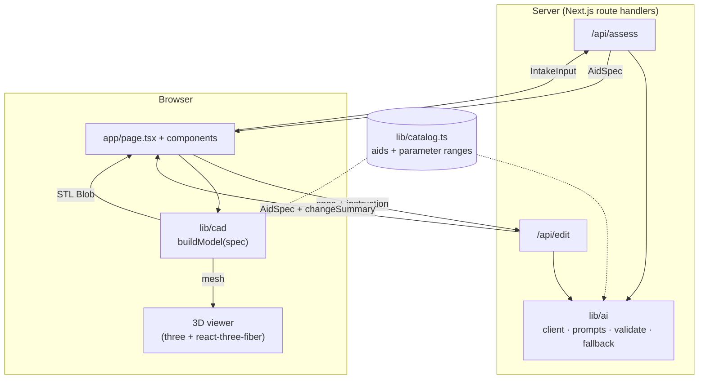

# Architecture

Grippy turns a sentence into a printable object in three stages: **decide** (AI), **shape** (geometry), **show and export** (UI). The only thing that passes between stages is a small, validated parameter object, the `AidSpec`.



## The contract

Everything is typed in [`lib/types.ts`](../lib/types.ts):

- **`IntakeInput`**: the user's problem plus optional hand size and grip strength.
- **`AidSpec`**: which aid (`aidType`), a title, a short rationale, `params` in millimetres, safety notes and an estimated mass in grams.
- **`MeshData`**: non-indexed `positions` and `normals` (`Float32Array`, 9 floats per triangle).

[`lib/catalog.ts`](../lib/catalog.ts) lists the aids and, for each parameter, a label, a minimum, a maximum and a default. It is the single source of truth: the AI prompts are generated from it, the validator clamps to it, and the 3D engine clamps to it again.

## Defence in depth: bad input never reaches the geometry

| Layer | Where | What it guarantees |
|---|---|---|
| Prompt | `lib/ai/prompts.ts` | The model sees the catalog and its ranges, and must answer in JSON |
| Parse + retry | `lib/ai/client.ts` | Strips code fences and retries once on invalid JSON |
| `clampSpec` | `lib/ai/validate.ts` | Unknown params dropped, missing filled with defaults, everything clamped, `estGrams` filled in |
| Offline fallback | `lib/ai/fallback.ts` | `/api/assess` still returns a sensible spec if the API call fails or no key is set |
| `buildModel` | `lib/cad/index.ts` | Clamps again; never throws (default model for that aid, then a plain block) |

## 3D engine (`lib/cad`)

```
lib/cad/
  index.ts          buildModel(spec) -> { mesh, stl }
  templates/        keyTurner.ts · penGrip.ts · utensilHandle.ts   (spec params -> Geom3, mm)
  revolve.ts        profile builder + revolve helper (axisymmetric parts)
  triangulate.ts    Geom3 -> clean triangle list (drops zero-area slivers)
  mesh.ts           triangles -> y-up MeshData with smooth normals
  stl.ts            triangles -> binary STL Blob
```

### Coordinate frames

| Output | Frame | Why |
|---|---|---|
| STL | millimetres, **z-up**, flat base at **z = 0** | Slicers expect z-up and a part that sits on the bed |
| `mesh` | **y-up**: `(x, y, z) -> (x, z, -y)` | three.js is y-up, so the viewer needs no rotation |

### How each aid is built

- **Pen grip and utensil handle** are axisymmetric, so each is one polygon profile (radius vs. height) revolved around the z axis. The pen grip's through-hole and its ring grooves are part of that profile, so it needs **no boolean operations**. The utensil handle revolves a solid profile and subtracts one rectangular slot.
- **Key turner** is two rounded cuboids (head and handle) united, with a slot subtracted from the head and, optionally, cylinders subtracted across the handle for finger grooves. It uses booleans, so it is the slowest of the three.

Measured in a Node dev container: pen grip and utensil handle build in roughly 5-110 ms; the key turner in roughly 90-350 ms (grooves on is the slow end). Fast enough for the edit-by-talking loop to feel immediate.

### Design decisions worth knowing

- **Not `roundedCylinder`.** JSCAD's `roundedCylinder` makes *domed* ends that touch z = 0 only at a single point, which cannot sit flat on a print bed (and a pen grip's hole removes that point). The revolved profiles have a real flat base with filleted edges instead.
- **Own STL writer.** JSCAD's boolean operations leave zero-area triangles. Slicers dislike them, so both the mesh and the STL are written from the same cleaned triangle list, and `@jscad/stl-serializer` is not used at runtime.
- **Smooth shading with a crease angle.** Vertex normals are averaged across faces within 40 degrees, so rounded parts look round while the sharp edges (slots, grooves) stay crisp.
- **Print allowances are constants.** Key slot 3 mm, pen-hole clearance +0.3 mm, minimum wall 2 mm, at the top of each template. The pen hole and the utensil slot are also limited so a minimum wall always remains.

### Verification

`npm run verify:cad` ([`scripts/verify.ts`](../scripts/verify.ts)) builds every aid in the catalog at min, default, max and mixed-extreme parameters, with grooves on and off, and checks mesh/STL consistency, finite numbers, base at z = 0, positive volume and a closed surface. It also feeds garbage specs (NaN, strings, an unknown aid, missing params) to confirm `buildModel` never throws. Because it iterates the catalog, a new aid is covered automatically.

## Adding an aid

1. **Catalog**: add the aid and its parameter ranges to `lib/catalog.ts`, and its id to the `AidType` union in `lib/types.ts`.
2. **Template**: add `lib/cad/templates/<aid>.ts` (mm, z-up, flat base at z = 0) and a `case` for it in `makeGeom` in `lib/cad/index.ts`.
3. **Mass estimate**: add a branch for it in `estimateGrams` in `lib/ai/validate.ts`.
4. **Offline fallback**: add keywords and a rationale for it in `lib/ai/fallback.ts`.
5. **Price**: add an entry to `data/prices.json` with a source.
6. **Check**: run `npm run check`. The AI prompts pick up the new aid automatically because they are generated from the catalog.

## Known limits

- Three aids only; `/api/edit` can only change the parameters the chosen aid exposes.
- Mass is an estimate (20% infill assumption), not a slicer result.
- Models are single solid bodies with no supports; the key turner's slot opens on its top face.
